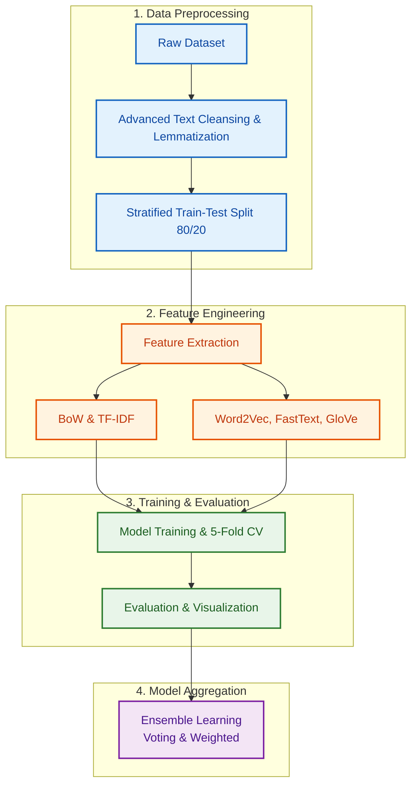

# 🎬 Sentiment Analysis with Machine learning and Ensemble

โปรเจกต์วิเคราะห์อารมณ์และจำแนกความรู้สึกจากข้อความรีวิวบนชุดข้อมูล IMDb,Yelp,Amazon Dataset โดยประยุกต์ใช้การทำความสะอาดข้อความ (Advanced Text Cleansing & Lemmatization), การแปลงข้อเป็นเวกเตอร์หลายรูปแบบ (BoW, TF-IDF, Word2Vec, FastText, GloVe), การเปรียบเทียบประสิทธิภาพโมเดล Machine Learning 5 อัลกอริทึม ทั้งในรูปแบบ Train-Test Split (80/20) และ 5-Fold Cross Validation รวมถึงการนำโมเดลมารวมพลังด้วยเทคนิค Ensemble Learning (Hard Voting, Soft Voting, Weighted Ensemble)

## 📌 คุณสมบัติเด่นของโปรเจกต์ (Key Features)

1. **Advanced Text Preprocessing**:

   * ลบแท็ก HTML และขยายคำย่อ (Contractions Expansion) เช่น `can't` -> `cannot`

   * แปลงคำบอกคะแนนและอีโมจิเป็นสัญลักษณ์อารมณ์ เช่น `10/10` -> `perfect`, `:-)` -> `smile`

   * คัดเลือก Custom Stopwords โดย **คงไว้ซึ่งคำปฏิเสธ (Negation)** และ **คำเน้นระดับอารมณ์ (Intensifiers)** เช่น `not`, `never`, `very`, `extremely`, `but` เพื่อป้องกันการสูญเสียบริบททางอารมณ์

   * ทำ **POS-Guided Lemmatization** คืนรูปคำมูลฐานตามชนิดของคำด้วย NLTK WordNet

2. **Feature Representations (5 รูปแบบ)**:

   * **Bag of Words (BoW)** (Unigram + Bigram)

   * **TF-IDF Vectorizer** (Sublinear Scaling, Unigram + Bigram)

   * **Word2Vec** (`word2vec-google-news-300` - TF-IDF Weighted)

   * **FastText** (`fasttext-wiki-news-subwords-300` - TF-IDF Weighted)

   * **GloVe** (`glove-wiki-gigaword-300` - TF-IDF Weighted)

3. **Machine Learning Classifiers (5 โมเดลหลัก)**:

   * **ANN / MLPClassifier** (Artificial Neural Network)

   * **Random Forest Classifier**

   * **Linear SVM** (Support Vector Machine)

   * **Logistic Regression**

   * **Naive Bayes** (MultinomialNB สำหรับ BoW/TF-IDF และ GaussianNB สำหรับ Word Embedding)

4. **Comprehensive Evaluation**:

   * การวัดผลแบบ **80/20 Train-Test Split**

   * การวัดผลแบบ **5-Fold Stratified Cross-Validation**

   * รายงานผลด้วยค่า **Accuracy, Precision, Recall, F1-Score**

   * กราฟเปรียบเทียบผลลัพธ์: Confusion Matrix Heatmaps, Radar Charts, Bar Plots และ Line Charts

5. **Ensemble Learning Techniques**:

   * **Hard Voting Ensemble** (โหวตเสียงข้างมาก)

   * **Soft Voting Ensemble** (เฉลี่ยค่าความน่าจะเป็น)

   * **Weighted Ensemble** (ถ่วงน้ำหนักตามความเก่งของโมเดลด้วยค่า F1-Score)

## 📊 รายละเอียดชุดข้อมูล (Dataset)

* **Source**: IMDb Labelled Dataset (`imdb_labelled.txt`), YELP Labelled Dataset (`yelp_labelled.txt`), AMAZON Labelled Dataset (`amazon_labelled.txt`)

* **Total Samples**: 1,000 ข้อความรีวิวภาษาอังกฤษ

* **Data Balance**: สมดุล 50:50

  * `1` = **Positive** (ความรู้สึกเชิงบวก / ชื่นชอบ) - 500 ตัวอย่าง

  * `0` = **Negative** (ความรู้สึกเชิงลบ / ไม่ประทับใจ) - 500 ตัวอย่าง

* **Format**: File TSV (`\t` separated) ประกอบด้วย Column ข้อความรีวิว และ Label

## 🛠️ โครงสร้างไฟล์ใน Repositories

```
├── Dataset/
│   └── imdb_labelled.txt               # ชุดข้อมูล IMDb Labelled Dataset
│   └── yelp_labelled.txt               # ชุดข้อมูล YELP Labelled Dataset
│   └── amazon_labelled.txt             # ชุดข้อมูล AMAZON Labelled Dataset
├── IMDB_ensemble.ipynb                 # Jupyter / Colab Notebook หลักของ imdb
├── YELP_ensemble.ipynb                 # Jupyter / Colab Notebook หลักของ yelp
├── AMAZON_ensemble.ipynb               # Jupyter / Colab Notebook หลักของ amazon
├── ผลของงาน NLP (IMDB,YELP,AMAZON)     # ผลของงานที่บันทึกใน excel
└── README.md                           # อธิบายโปรเจกต์และวิธีการใช้งาน

```

## 🚀 วิธีการนำไปใช้ / การติดตั้งและเรียกใช้งาน (How to Run)

###  รันบน Google Colab 

1. **อัปโหลดไฟล์ไปยัง Google Drive**:

   * สร้างโฟลเดอร์ใน Google Drive ชื่อ `Colab Notebooks/Dataset`

   * นำไฟล์ `imdb_labelled.txt`,`yelp_labelled.txt`,`amazon_labelled.txt` ไปวางไว้ในโฟลเดอร์ `Dataset/`

2. **เปิดไฟล์ Notebook บน Google Colab**:

   * อัปโหลดไฟล์ `.ipynb` ขึ้น Google Colab

3. **เรียกใช้การเชื่อมต่อ Google Drive**:

   * รันเซลล์แรกๆ ใน Notebook เพื่อทำการ `drive.mount('/content/drive')`

4. **รันเซลล์ตามลำดับ**:

   * สามารถกด `Runtime` -> `Run all` เพื่อรันการทำงานทั้งหมดตั้งแต่ Data Preprocessing จนถึง Ensemble Learning
     

## 🔄 ขั้นตอนการประมวลผลโมเดล (Pipeline Overview)



1. **Text Cleansing**: ลบตัวอักษรขยะ, ขยายคำย่อ, ปรับแต่ง Stopwords ให้เหลือคำปฏิเสธและคำแสดงอารมณ์, ทำ Lemmatization ด้วย POS Tagging

2. **Vectorization & Word Embeddings**: แปลงข้อความความยาวแปรผันเป็นเวกเตอร์ตัวเลขที่มีขนาดคงที่

3. **Model Training**: เทรนโมเดล 5 ประเภทผ่าน Feature Representations แต่ละแบบ

4. **Evaluation**:

   * สรุปตารางเปรียบเทียบ Accuracy, Precision, Recall, F1-Score

   * แสดง Confusion Matrix เพื่อดูการทายผิดพลาด (False Positive / False Negative)

   * วาด Radar Chart และ Trend Line Comparison

5. **Ensemble Learning**: คัดเลือกโมเดลที่มีประสิทธิภาพสูงสุด (Top Models) มารวมผลทำนายเพื่อเพิ่มความแม่นยำและความเสถียร

## 📈 ผลการทำงาน

* สามารถดูราละเอียดผลได้ที่ไฟล์ (ผลของงาน NLP (IMDB,YELP,AMAZON)) หรือที่ลิงค์ https://docs.google.com/spreadsheets/d/1siagjH-iOd4BM9IVo3FKViE8D7l83o7Dy7d0q8VEf-0/edit?usp=sharing

* สามารถดูผลบน colab ได้ดังนี้
    * IMDB   = https://colab.research.google.com/drive/1Tois4CMqL0frTL1rjQeVlvHKXHrysKEM?usp=sharing
    * YELP   = https://colab.research.google.com/drive/1yjKrk88bE8drWA_w4Y_3GeckxZB3r9Te?usp=sharing
    * AMAZON = https://colab.research.google.com/drive/13ScnIUEIKRoLf-a34fRojCmVkrNdDVMD?usp=sharing
